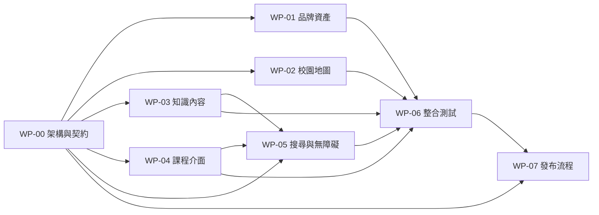

# Rotarylearning 協作開發工作包

## 1. 目標

將目前可運作的靜態網站拆成可平行開發、可獨立驗收、可安全合併的工作包，讓設計、內容、前端與部署人員不必同時修改同一個大型檔案。

本輪成功條件：

- 每個工作包都有唯一主要負責人、明確檔案範圍及驗收條件。
- 內容資料、校園互動、課程介面、搜尋及視覺資產彼此分離。
- 任一工作包完成後，都能用 Pull Request 單獨檢查及回復。
- `main` 分支維持隨時可部署到 Cloudflare Pages。
- 手機可滑動地圖、桌機操作及現有內容在拆分後不退步。

## 2. 本輪不包含

- 不重做整張校園底圖。
- 不恢復可自由走動的 3D 人物系統。
- 不導入會員登入、學習紀錄或後台 CMS。
- 不一次改成大型前端框架；先維持無建置工具的 HTML、CSS、JavaScript 架構。

上述需求若重新啟動，應另外建立新的產品工作包，不混入這次的模組拆分。

## 3. 目前狀況與主要風險

目前網站直接由 `dist/` 部署，結構簡單，但協作風險集中在兩個檔案：

- `dist/app.js` 同時包含連結、學區資料、31 項內容、抽屜介面、搜尋及手機地圖邏輯。
- `dist/styles.css` 同時包含設計變數、地圖、按鈕、內容抽屜、搜尋及所有響應式規則。

因此，第一個工作包必須先建立模組邊界。這是其他工作包能安全平行開發的前置條件。

## 4. 目標目錄結構

本階段仍保留 `dist/` 為可直接部署的網站來源，不增加打包器：

```text
dist/
├── index.html
├── css/
│   ├── tokens.css
│   ├── shell.css
│   ├── campus.css
│   ├── drawer.css
│   ├── search.css
│   └── responsive.css
├── js/
│   ├── main.js
│   ├── campus.js
│   ├── drawer.js
│   ├── search.js
│   └── motion.js
├── data/
│   ├── links.js
│   ├── rooms.js
│   └── lessons.js
└── assets/
    ├── brand/
    ├── campus/
    └── ui/
docs/
├── WORK_PACKAGES.md
├── CONTENT_SCHEMA.md
└── QA_CHECKLIST.md
```

所有 JavaScript 改為瀏覽器原生 ES Modules，由 `js/main.js` 組合各模組；不需要 npm install 或編譯即可預覽。

## 5. 共用介面契約

所有工作包只透過以下穩定介面合作：

### 內容資料

- `rooms`：學區名稱、說明、卡片、主要行動及注意事項。
- `lessons`：課程名稱、所屬學區、學習重點、實作、檢核與來源。
- `links`：RI、My Rotary、Google Drive 等共用官方來源網址。
- 每筆學區及課程都有不變的唯一 `id`；畫面文字可改，`id` 不任意更名。

### 互動事件

- 地圖與手機導覽只負責送出「開啟學區」事件。
- 搜尋只負責回傳「學區或課程 ID」。
- 抽屜模組是唯一負責顯示學區與課程內容的模組。
- 各模組不得直接複製另一模組的 HTML 模板或內容資料。

### 品牌資產

- Logo 只能由 `assets/brand/` 取用，不自行重畫、變形或改色。
- 校園底圖由 `assets/campus/` 管理；熱點座標由地圖工作包管理。
- 替換底圖若改變尺寸或構圖，必須通知地圖負責人重新驗證所有熱點。

完整欄位定義由 WP-00 寫入 `docs/CONTENT_SCHEMA.md` 後凍結；後續變更需由整合負責人審核。

## 6. 工作包清單

| ID | 工作包 | 主要負責角色 | 專屬檔案 | 前置依賴 |
|---|---|---|---|---|
| WP-00 | 架構拆分與共同契約 | 技術整合負責人 | `index.html`、`js/main.js`、`docs/CONTENT_SCHEMA.md` | 無 |
| WP-01 | 品牌視覺與圖像資產 | UI／視覺設計 | `css/tokens.css`、`assets/` | WP-00 |
| WP-02 | 校園地圖與手機操作 | 前端互動開發 | `js/campus.js`、`css/campus.css`、`css/responsive.css` 的地圖段落 | WP-00 |
| WP-03 | 扶輪知識內容與來源 | 內容編輯／扶輪知識審查 | `data/`、`docs/CONTENT_SCHEMA.md` 的內容範例 | WP-00 |
| WP-04 | 學區與課程學習介面 | 前端介面開發 | `js/drawer.js`、`css/drawer.css` | WP-00，可使用測試資料與 WP-03 平行 |
| WP-05 | 搜尋、導覽與無障礙 | 前端／UX 開發 | `js/search.js`、`js/motion.js`、`css/search.css`、`css/shell.css` | WP-00；整合時需要 WP-03、WP-04 |
| WP-06 | 整合測試與內容校對 | QA／內容審查 | `docs/QA_CHECKLIST.md` | WP-01～WP-05 |
| WP-07 | GitHub 與 Cloudflare 發布 | 技術整合／維運 | `wrangler.toml`、`.github/`、`README.md` | WP-00；正式發布需要 WP-06 |

### WP-00　架構拆分與共同契約

交付內容：

- 將現有 `app.js` 及 `styles.css` 依目標結構拆檔，不改變畫面或功能。
- 建立內容欄位定義、模組匯入方式及共用事件規格。
- 建立最小本機檢查流程，確保所有 ES Modules 能被瀏覽器載入。

驗收條件：

- 桌機與手機畫面和拆分前一致。
- 校園熱點、手機導覽、抽屜、搜尋、暫停動畫均可使用。
- Console 沒有錯誤；所有本機資產與模組回應成功。
- 後續工作包不需要再修改原本的 `dist/app.js` 或 `dist/styles.css`。

### WP-01　品牌視覺與圖像資產

交付內容：

- 管理正確扶輪 Logo、校園底圖、介面圖示與檔案命名。
- 整理色彩、字體、陰影、圓角、間距等 design tokens。
- 提供圖片尺寸、格式、壓縮與替換規則。

驗收條件：

- Logo 比例、留白與色彩符合扶輪品牌規範。
- 圖片在手機與桌機皆清晰，且沒有不必要的超大檔案。
- 視覺資產替換不會破壞熱點座標或文字可讀性。

### WP-02　校園地圖與手機操作

交付內容：

- 維護桌機校園比例、學區熱點座標與互動回饋。
- 維護手機地圖縮放、初始位置、左右滑動及下方快速導覽。
- 定義底圖替換後的座標校準流程。

驗收條件：

- 360、390、430 px 寬度手機均可手動滑到地圖左右邊界。
- 地圖初始位置合理，但不會被強制鎖回中央。
- 五個熱點在桌機及手機都對準正確建築。
- 觸控滑動不會誤開學區，鍵盤仍可操作各熱點。

### WP-03　扶輪知識內容與來源

交付內容：

- 維護五大學區、各班級、七大焦點領域與活動內容。
- 檢查 RI 官網、My Rotary、Google Drive 原始資料的來源與版本。
- 清楚標示官方文件、中文參考譯本與地區整理教材。

驗收條件：

- 每個學區都有說明、內容卡片、主要行動與注意事項。
- 每堂課都有學習重點、實作、理解檢核及至少一個來源。
- 外部連結可開啟，日期敏感資料有版本或查核日期。
- 內容修改不需要碰觸 UI 或互動程式碼。

### WP-04　學區與課程學習介面

交付內容：

- 負責學區抽屜、內容卡片、課程頁、返回與關閉流程。
- 根據資料契約渲染內容，不在模組內寫死課程資料。
- 管理抽屜開啟後的焦點、捲動位置及背景遮罩。

驗收條件：

- 從地圖、手機導覽及搜尋進入同一內容時結果一致。
- 課程可返回原學區，關閉後焦點回到原觸發按鈕。
- 長內容可捲動，手機鍵盤與瀏覽器返回操作不造成卡住。

### WP-05　搜尋、導覽與無障礙

交付內容：

- 搜尋學區、課程名稱、摘要與關鍵字。
- 維護頂部導覽、歡迎訊息、動畫暫停及減少動態設定。
- 補齊語意標籤、鍵盤操作、焦點樣式及螢幕閱讀器文字。

驗收條件：

- 空白、無結果、中文關鍵字及多筆結果都有正確狀態。
- 全站可只用鍵盤完成進入學區、開課、返回與關閉。
- `prefers-reduced-motion` 生效，動畫暫停按鈕狀態正確。
- 搜尋結果不自行渲染課程頁，而是呼叫 WP-04 的公開介面。

### WP-06　整合測試與內容校對

交付內容：

- 建立功能、響應式、瀏覽器、連結、內容及發布檢查表。
- 對整合版本執行回歸測試並記錄證據。
- 將問題回派至原工作包，不直接在 QA 分支大量改寫功能。

驗收條件：

- Chrome、Safari 最新穩定版通過主要流程。
- 桌機、平板、手機直向及橫向完成視覺與操作檢查。
- 無阻斷性錯誤、斷鏈、錯誤 Logo 或無法關閉的對話框。
- 發布前檢查表由產品負責人及 QA 共同確認。

### WP-07　GitHub 與 Cloudflare 發布

交付內容：

- 維護本機預覽、部署指令、環境資訊及故障回復說明。
- 設定 GitHub Pull Request 檢查及 Cloudflare Pages 發布方式。
- 每次正式發布記錄 commit、網址、檢查結果與已知問題。

驗收條件：

- 新協作者可只看 README 完成本機啟動。
- 合併 `main` 後能以固定流程發布，且知道如何回復前一版本。
- 正式網址、版本 commit 與部署紀錄可互相追溯。

## 7. 依賴與開發順序



建議里程碑：

1. M1：WP-00 完成，目錄與資料契約凍結。
2. M2：WP-01～WP-05 平行開發並各自通過工作包驗收。
3. M3：WP-06 在整合分支完成回歸、內容與品牌查核。
4. M4：WP-07 發布 `main`，記錄版本與回復點。

## 8. 人員配置

### 三人精簡配置

- 技術整合：WP-00、WP-02、WP-07。
- UI／前端：WP-01、WP-04、WP-05。
- 內容／QA：WP-03、WP-06。

### 五人建議配置

- 技術整合與發布：WP-00、WP-07。
- 視覺設計：WP-01。
- 地圖互動：WP-02。
- 扶輪內容：WP-03，並參與 WP-06 內容驗收。
- 學習介面：WP-04、WP-05，並參與 WP-06 功能驗收。

無論人數多少，每個工作包只指定一位直接負責人；可以多人協作，但不能多人同時對結果負責。

## 9. Git 與合併規則

- `main` 只接受 Pull Request，不直接修改。
- 分支格式：`work/wp-02-campus-map`。
- PR 標題格式：`[WP-02] 改善手機地圖滑動`。
- 一個 PR 只處理一個工作包；跨檔案所有權時，在 PR 中標註共同審查人。
- 合併前同步最新 `main`，由工作包負責人處理自己範圍內的衝突。
- PR 必須附上：變更摘要、受影響檔案、桌機／手機驗證、畫面證據、已知限制及回復方式。
- 資料契約、共用事件、Logo 或校園底圖尺寸的改動，需要技術整合負責人核准。

## 10. 開發完成定義

每個工作包必須同時符合以下條件才算完成：

- 工作包自己的驗收條件全部通過。
- 沒有修改未授權的其他工作包檔案，或已取得該負責人審查。
- 桌機與手機主要流程皆有驗證。
- 沒有 Console 錯誤、404 資源或明顯無障礙退步。
- 文件、資料契約或操作方式有改變時，README 或對應文件已同步。
- PR 已由至少一位非作者審查並合併。

## 11. 第一輪分派建議

第一張任務只建立 WP-00；其他人可同時閱讀契約草案、整理素材與內容，但暫不大量改寫現有檔案。WP-00 合併後立即分派 WP-01～WP-05，WP-06 從各工作包的第一個 PR 開始建立測試紀錄，WP-07 負責最後整合與發布。

需要產品負責人確認的事項：

- 實際參與人數與每位成員的角色。
- 是否保留「無框架、直接部署 `dist/`」的技術方向。
- 哪一位扶輪專業人員擔任內容與來源的最終審查者。
- `main` 的 GitHub 保護規則與 Cloudflare 發布權限由誰持有。
